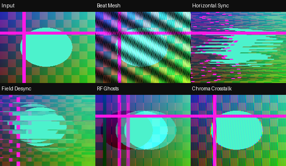
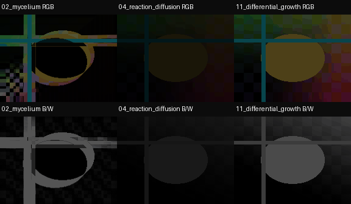
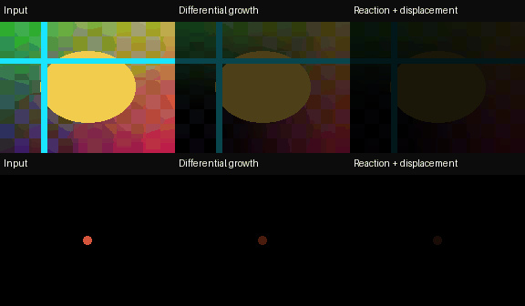

# RecurBoy FB Growth — 11 эффектов

[Все подборки](https://github.com/Guadonna/recurboy_fx_shaders/tree/main) · Ветка `collections/fb-growth`

[Скачать ZIP v0.4.1](https://github.com/Guadonna/recurboy_fx_shaders/releases/download/collections-v1.2.0/recurboy-fb-growth-v0.4.1.zip)

**v0.4.1: прежняя подборка переименована в FB Growth, шейдеры сохранены. reaction diffusion без displacement, с управлением размером частиц от 3 до 31 пикселя.** Однопроходные FX для [cyberboy666/recurBOY](https://github.com/cyberboy666/recurBOY), GLES 2.0 / GLSL ES 1.00. По-прежнему 3–7 чтений текстуры, без дополнительных буферов со стороны шейдеров. Версия предварительная: 25 FPS и температура на Raspberry Pi ещё не измерены.

## Установка и обновление

1. Распакуйте релизный ZIP. Замените одноимённые `.frag` в `~/Fx/` на Pi либо в папке `Fx` в корне USB-накопителя. Не копируйте ZIP целиком в меню FX. Для работы шейдеров Python и сборка не нужны.
2. В RecurBoy перейдите вправо в FX, выберите эффект и нажмите SELECT. Кнопка FX включает обработку. Регулируйте эффект на странице EFFECT: на странице PATTERN ручки относятся к исходному генератору.
3. При переключении/обновлении эффекта подержите **ручку 0 в нуле несколько кадров**, затем поднимайте. Это выводит исходное видео и перезаписывает feedback им. Для полностью чёрного старта используйте чёрный источник при Wet=0.
4. Отправная точка: **ручки 0/1/2 = `1.0 / 0.55 / 0.70`**. Для reaction diffusion начните с **`1.0 / 0.20 / 0.70`** (ячейка 7 px), затем увеличивайте размер второй ручкой. После обновления заново выберите эффект и сбросьте прежнее состояние feedback.

## Ручки

Ручка 0 — Wet (0…100%). Она одновременно меняет подмешивание источника в память; уменьшение Wet влияет и на развитие узора. Низкие значения дают исходное изображение с эффектом, максимум — полный эффект.

Ручки 1 и 2 — из таблицы ниже. У большинства размеров/деформаций квадратичная кривая: первая половина удобна для точной настройки, вторая быстро разгоняет эффект. Ручка 3 управляет скоростью времени у liquid/temporal/elastic. **В reaction diffusion четвёртая ручка не используется. Размер частиц регулирует ручка 1 (вторая физическая), ручка 2 — восстановление и частоту волн.** Feedback обновляется каждый кадр, даже при остановленном масштабированном времени.

| Файл | Характер | Ручка 1 | Ручка 2 | Чтений |
|---|---|---|---|---:|
| `01_liquid_memory.frag` | Жидкие вихри и длинные вязкие шлейфы | Поток: 0.3…36.3 px, зум до 5.5% | Память: 32…99.8% | 4 |
| `02_mycelium.frag` | Разветвлённые цветные нити и колонии | Шаг: 0.75…18.75 px | Питание, разрастание и удержание | 7 |
| `03_erosion.frag` | Разрывы рельефа, потоки и резкие уступы | Перенос: 0.5…42.5 px | Осаждение и усиление перепадов | 5 |
| `04_reaction_diffusion.frag` | Цветные волны и пятна от светлых объектов | Размер частиц: 3…31 px | Скорость восстановления / частота волн | 7 |
| `05_temporal_refraction.frag` | Сильное преломление памяти и тоннели | Деформация до десятков пикселей, зум до 18% | Память и глубина следа | 3 |
| `06_magnetic_ink.frag` | Вытянутые магнитные штрихи | Направление поля: 0…315° | Длина, память и плотность чернил | 5 |
| `07_crystallization.frag` | Крупные ромбические грани | Размер сетки: 2…112 px | Удержание и 12…2 уровня цвета | 3 |
| `08_elastic_membrane.frag` | Глубокие волны, растяжение и дрожание | Сила деформации: 0.5…150.5 | Инерция: 5…97% | 5 |
| `09_digital_fossils.frag` | Сдвигающиеся, масштабируемые слои | Смещение до 40.25 px, зум до 12% | Память, 18…3 уровня цвета | 3 |
| `10_capillary_watercolor.frag` | Сильное растекание и тёмные края пигмента | Радиус: 0.75…25.75 px | Плотность и потемнение краёв | 6 |
| `11_differential_growth.frag` | Фронты от видео с переносом цвета и деформацией источника | Шаг: 1…3.5 px, деформация до 25 | Скорость восстановления / частота роста | 7 |

Пиксельные расстояния относятся к фактическому FX framebuffer. Длина магнитных штрихов и амплитуда мембраны дополнительно зависят от поля/видео; значения таблицы не означают число дополнительных выборок. Положение ручек не добавляет проходов или циклов.

Быстрые положения для ручек **0 / 1 / 2** (вводятся вручную):

- **Контуры:** `0.85 / 0.25 / 0.50` — мелкие детали с читаемым исходником.
- **Живой поток:** `1.00 / 0.55 / 0.70` — основное положение новой версии.
- **Срыв:** `1.00 / 0.85 / 0.95` — крупная геометрия, длинная память, сильный контраст. Для возврата на секунду опустите Wet в ноль.

## Цвет и рост

**Differential growth** снова запускает фронты от видео, с возбуждением и восстановлением после их прохождения — как визуальный принцип первой версии. Убран искусственный вихрь вокруг центра экрана. Градиент растущего фронта смещает выборку исходного видео; цвет распространяется с соседними пикселями feedback и выходит за исходные границы объекта.

**Reaction diffusion** использует одинаковые расстояния и веса соседей сверху, снизу, слева и справа. Возбуждение накапливается из всех четырёх направлений, светлые участки видео запускают новые волны. Фиксированной диагональной оси больше нет. Четырёхточечная сетка может оставлять лёгкую угловатость фронтов; идеальная круговая симметрия не заявляется.

Displacement полностью удалён. Вместо отдельных состояний каждого пикселя диффузия развивается на общей сетке: ручка 1 меняет её шаг **3…31 px**, а промежутки сглаживаются при выводе. С увеличением размера получаются более крупные пятна и широкие фронты. Изменение ступенчатое, по 2 px. После резкой смены размера сбросьте Wet: старое состояние должно перестроиться под новую сетку. Крупная сетка может пропускать детали видео меньше ячейки.

Для управления размером и обновления эффекта достаточно заменить `.frag`. Дополнительные uniform-параметры хоста больше не используются.

У этих двух эффектов цвет теперь хранится и переносится в feedback, а не берётся заново из каждого текущего пикселя как окраска маски:

- Цветной объект запускает фронты своего цвета, в том числе на чёрном фоне; встречающиеся цвета могут смешиваться.
- ЧБ-вход с чистым feedback остаётся ЧБ. Нет заданной зелёной или розовой палитры.
- После смены цветного источника на ЧБ старые цветные следы могут сохраняться. Для немедленного перехода подержите Wet=0 несколько кадров. Это очищает цвет старого состояния.

Мицелий сохраняет схему v0.2: оттенок берётся из текущего пикселя видео. Остальные эффекты также могут сохранять цвет старых следов до сброса.

Технически новые growth/reaction — возбудимые среды с фазой восстановления, записанной в интенсивности RGB. Они воспроизводят принцип распространяющихся фронтов первой версии, но **не являются точным возвратом двухкомпонентных уравнений v0.1**: в штатном RGB8 нет отдельного поля для химического состояния и произвольного видимого цвета. Reaction diffusion не является точной Gray–Scott; differential growth остаётся растровым эффектом без сетки вершин. Дополнительных проходов и скрытой упаковки битов нет.

## Производительность и совместимость

Базовая цель — Pi Zero / Zero W и Zero 2 W, SD-вывод и штатный лимит 30 FPS. Reaction diffusion использует 7 выборок вместо 6 в v0.3.0, остальные бюджеты сохранены; цветовая арифметика — `mediump`, координаты точнее при доступном `highp`. Нет ray marching, циклов, шумовых октав или float-текстур. Некоторые формулы стали сложнее: равное число выборок не гарантирует равную скорость.

**25 FPS и температура требуют замера на устройстве.** Шейдеры не измеряют температуру, не меняют частоты и не могут гарантировать отсутствие перегрева. [Проверка производительности и необязательный термомонитор](docs/performance.md) включены в архив. Уменьшение размера видео без изменения FX framebuffer не снижает стоимость рендера.

В исследованном upstream feedback читает framebuffer, в который одновременно пишет. Для переносимого результата нужны два чередующихся буфера; приложен прежний патч к addon, проверенный только на применимость. [Совместимость и точные ревизии](docs/compatibility.md). Патч автоматически не устанавливается и на Pi нами не собран.

Temporal refraction использует одну рекурсивную память, без массива независимых прошлых кадров. Elastic membrane, кристаллизация, эрозия и акварель — художественные модели для ограниченного GPU.

## Проверки и примеры

Из корня исходного репозитория, на Linux с EGL/Mesa:

```sh
python3 -m venv .venv
.venv/bin/pip install -r requirements-dev.txt
EGL_PLATFORM=surfaceless .venv/bin/python tools/validate.py --frames 360
EGL_PLATFORM=surfaceless .venv/bin/python tools/validate_color_controls.py
EGL_PLATFORM=surfaceless .venv/bin/python tools/validate_fronts.py
.venv/bin/python -m unittest discover -s tests -v
.venv/bin/python tools/package.py
```

Первая проверка компилирует/линкует GLSL ES 1.00 и рендерит все эффекты с раздельными RGB8 буферами. Вторая проверяет ЧБ, диапазоны ручек и палитру мицелия. Третья проверяет перенос цвета за границы объекта, распространение по восьми секторам, смещение источника без привязки к центру экрана, размер фронтов и отсутствие зависимости от времени, четвёртой ручки и прежних uniform-параметров displacement. Это реальные результаты рендера Mesa, не замеры Pi. [Общий отчёт](docs/cloud-validation.json), [цвет и диапазоны](docs/color-controls.json), [фронты и размер частиц](docs/fronts-validation.json).







[Сравнение v0.3.0 / v0.4.0 при одинаковых ручках](docs/before-after.png) · [Весь диапазон ручек](docs/control-ranges.png)

Для воспроизведения сравнения передайте `--baseline /path/to/extracted-v0.3.0` в `validate_color_controls.py`. Обычная проверка и CI не требуют старой версии. Результаты пишутся в игнорируемую `artifacts/`; их копии в `docs/` относятся к релизной проверке.

Упаковщик создаёт воспроизводимый ZIP с 11 шейдерами, инструкциями, примерами, термомонитором и SHA-256 в `dist/`. CI проверяет ветку. Архив входит в общий релиз `collections-v1.2.0`; отдельные релизы подборок больше не публикуются автоматически.

Старая папка общего архива `feedback` теперь называется `fb-growth`. При обновлении переименуйте прежнюю папку в `fb-growth`, затем добавьте новую `feedback` с десятью классическими эффектами. Имена прежних 11 `.frag` сохранены.
