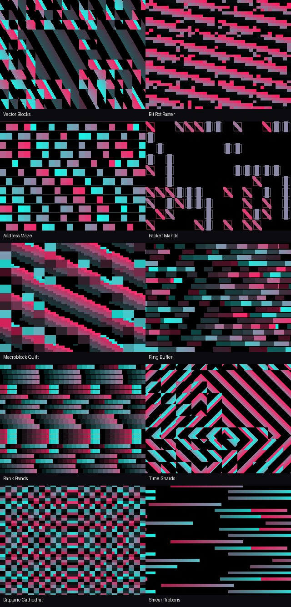
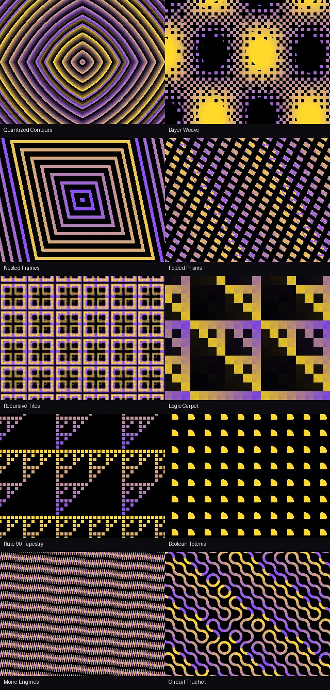
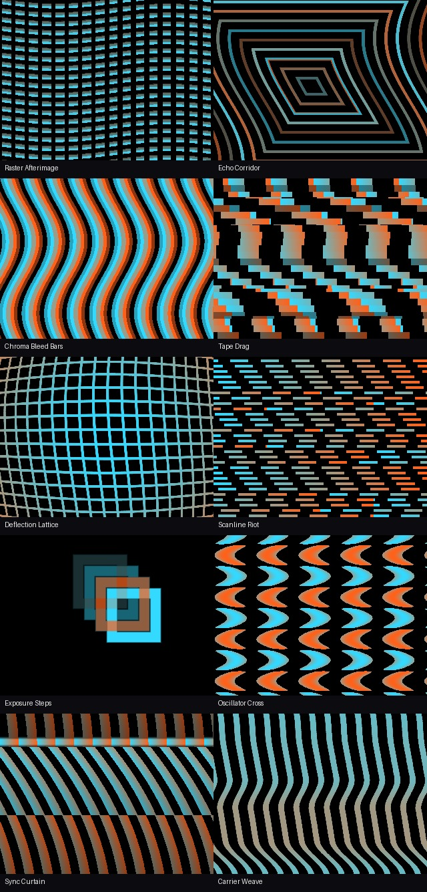
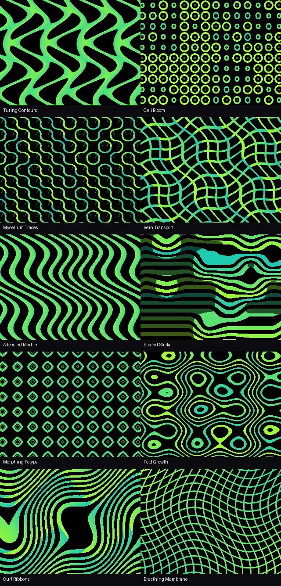
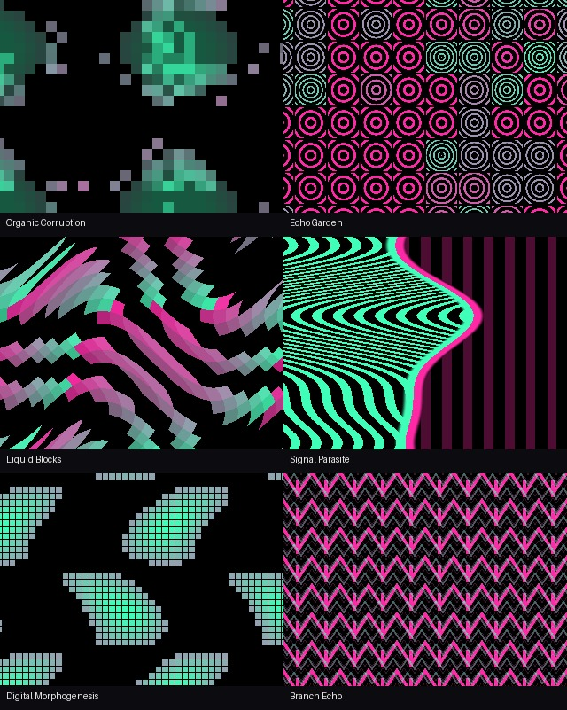

# RecurBoy Pattern Collections

[Главная](https://github.com/Guadonna/recurboy_fx_shaders/tree/main) · **Паттерны** · [FX](https://github.com/Guadonna/recurboy_fx_shaders/tree/fx)

**5 коллекций · 46 самостоятельных генераторов PATTERN для штатного RecurBoy.** Патчи, пересборка приложения, входное видео и дополнительные буферы не нужны.

**[Скачать все паттерны 0.2.1](https://github.com/Guadonna/recurboy_fx_shaders/releases/download/patterns-v0.2.1/recurboy-all-patterns-v0.2.1.zip)** · [Релиз и SHA256SUMS](https://github.com/Guadonna/recurboy_fx_shaders/releases/tag/patterns-v0.2.1) · [Общий каталог](https://github.com/Guadonna/recurboy_fx_shaders/tree/main)

## Коллекции

| Подборка | Шейдеров | Рисунок | Параметры каждого шейдера | Отдельный ZIP |
|---|---:|---|---|---|
| **Data Corrupt / Signal Decay** | 10 | Повреждённые блоки, битовые витражи, адресные штрихкоды, выпадающие пакеты и вытянутые кодовые ленты. | [Описание](collections/data-corrupt.md) | [ZIP](https://github.com/Guadonna/recurboy_fx_shaders/releases/download/patterns-v0.2.1/recurboy-patterns-data-corrupt-v0.1.0.zip) |
| **Digital / Computational** | 10 | Квантованные контуры, dithering, вложенные плитки, XOR/AND, Rule 90, булева геометрия, муар и соединённые дорожки. | [Описание](collections/digital.md) | [ZIP](https://github.com/Guadonna/recurboy_fx_shaders/releases/download/patterns-v0.2.1/recurboy-patterns-digital-v0.1.0.zip) |
| **Analog Echo / Electronic Memory** | 10 | Эхо-контуры, разъезд цветовых полос, магнитная протяжка, искривлённая решётка, дрожащая развёртка и биения. | [Описание](collections/analog.md) | [ZIP](https://github.com/Guadonna/recurboy_fx_shaders/releases/download/patterns-v0.2.1/recurboy-patterns-analog-v0.1.0.zip) |
| **Organic Nature / Emergent Systems** | 10 | Лабиринты, клеточные мембраны, грибные сети, мрамор, эрозия, розетки и органические складки. | [Описание](collections/organic.md) | [ZIP](https://github.com/Guadonna/recurboy_fx_shaders/releases/download/patterns-v0.2.1/recurboy-patterns-organic-v0.1.0.zip) |
| **Hybrid / Experimental** | 6 | Органическая порча, сад колец, жидкие блоки, паразит развёртки, цифровой морфогенез и ветвящееся эхо. | [Описание](collections/hybrid.md) | [ZIP](https://github.com/Guadonna/recurboy_fx_shaders/releases/download/patterns-v0.2.1/recurboy-patterns-hybrid-v0.1.0.zip) |

По одному самостоятельному паттерну на каждую из 46 идей списка. Темы с памятью и симуляцией воплощены как **процедурные визуальные интерпретации**: здесь нет настоящего фидбека, физической жидкости, многопроходной диффузии, агентов Physarum или порчи видеокодека. Это позволяет использовать штатный PATTERN-режим без изменения прошивки. Для настоящей видеообратной связи есть отдельные FX-подборки в общем каталоге.

## Установка

Из общего ZIP скопируйте папки подборок целиком в папку `/Shaders` в корне флешки. Получится:

```text
Shaders/
  data-corrupt/dc01_vector_blocks.frag
  digital/dg01_quantized_contours.frag
  analog/an01_raster_afterimage.frag
  organic/og01_turing_contours.frag
  hybrid/hy01_organic_corruption.frag
  ...
```

Внутри общего ZIP лежат только `подборка/*.frag`, без вложенных `Shaders/`, `Fx/`, README и служебных файлов. Отдельные ZIP уже содержат `Shaders/<подборка>/*.frag` и инструкцию: копируйте папку `Shaders` в корень флешки. В меню **PATTERN** откройте папку подборки, выберите шейдер и включите воспроизведение. Для первой проверки выключите FX, чтобы увидеть сам генератор и оценить его нагрузку.

## Ручки и CV

- **Ручка 1 / CV 1:** масштаб, плотность или количество элементов.
- **Ручка 2 / CV 2:** деформация, перестройка, тип взаимодействия или степень разрушения.
- **Ручка 3 / CV 3:** заполнение, толщина или порог плюс цветность. В нуле — чёрно-белый рисунок; при увеличении появляется цвет.
- **Ручка 4 / CV 4:** штатные скорость и направление времени RecurBoy; около середины — остановка. Отдельный четвёртый shader-uniform не требуется.

Точные назначения первых трёх ручек приведены в README каждой подборки. CV работают непрерывно, как в стандартном PATTERN. Для обычной модуляции параметров настройка `CV_BUTTON` должна быть выключена. Скорость и её направление зависят от штатной реализации часов RecurBoy.

## Производительность и проверка

Каждый шейдер: **один проход, 0 чтений текстур, 0 циклов**, максимум **3 sin/cos** в коде. Нет свечения, размытия, частиц, raymarching, тяжёлого шума, сортировочных переборов или дополнительных framebuffer. Для Recursive Tiling и Echo Growth используются три фиксированных масштаба; повторяющиеся формы вычисляются формулами. Служебное время ограничено периодом 1024 единицы; на границе возможна смена фазы.

Пройдены **2 898 сценариев** на Mesa EGL с GLSL ES 1.00 и штатным vertex shader в **320×240, 720×576 и 720×480**: все 46 файлов компилируются, начальные/крайние параметры рисуют изображение, каждая ручка меняет его, ч/б сохраняет равенство RGB, остановка времени стабильна, прямое и обратное время работают. Рендер выполняется без входных текстур. Пять тестов упаковки проверяют раздельные папки, отсутствие лишних файлов и точное совпадение содержимого.

**На Raspberry Pi FPS и температура ещё не измерены. Порог 25 FPS пока не подтверждён на устройстве.** Включённые одновременно FX добавляют свою нагрузку. Измерения Mesa в [отчёте](docs/validation.json) относятся только к облачной машине.

## Превью

Все изображения получены рендером этих шейдеров при средних положениях ручек. Это не запись с Raspberry Pi.

<details><summary>Data Corrupt — 10 паттернов</summary>



</details>
<details><summary>Digital — 10 паттернов</summary>



</details>
<details><summary>Analog — 10 паттернов</summary>



</details>
<details><summary>Organic — 10 паттернов</summary>



</details>
<details><summary>Hybrid — 6 паттернов</summary>



</details>

## Разработка и выпуск

```sh
python3 -m venv .venv
.venv/bin/pip install -r requirements-dev.txt
python3 tools/build_patterns.py
EGL_PLATFORM=surfaceless .venv/bin/python tools/validate_pattern.py
.venv/bin/python -m unittest discover -s tests -v
python3 tools/package.py
```

Исходники формул и метаданных — `tools/build_patterns.py`; сгенерированные `.frag`, `manifest.json` и README подборок хранятся в Git. Результаты проверки — `artifacts/`, архивы — `dist/patterns-v0.2.1/`. Для GLES нужны EGL/Mesa, PyOpenGL, numpy и Pillow.

Релиз `patterns-vX.Y.Z` создаётся тегом **этой ветки** после успешного CI: отдельный ZIP каждой коллекции, общий ZIP только с `подборка/*.frag` и внешний `SHA256SUMS`. Публикация через `.github/workflows/patterns.yml`. Опубликованные версии не перезаписываются. FX-релизы `collections-vX.Y.Z` ведутся отдельно. В `main` хранится только README-каталог.
