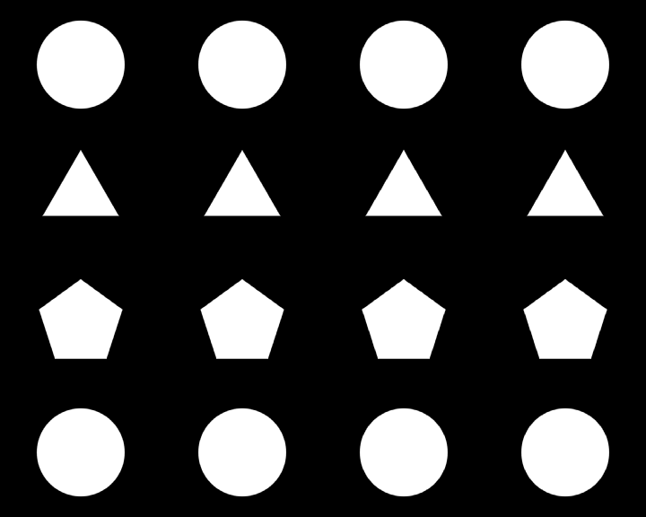

# RecurBoy Patterns — CV Matrix

Один тестовый генератор PATTERN: чёрно-белая матрица 4×4. Сверху вниз — окружности, треугольники, пятиугольники, окружности. Фигуры белые, фон чёрный; без CV экран полностью чёрный. Остальные четыре паттерна пока не создавались.

**Нужен приложенный программный патч и пересборка приложения RecurBoy.** Штатный PATTERN-хост не передаёт историю CV, события фронтов или предыдущий кадр. Один `.frag` не может запомнить случайный выбор между импульсами. На штатном хосте этот файл останется чёрным. Пайка не нужна; готового образа прошивки в архиве нет.

[Скачать тестовый комплект 0.1.0](https://github.com/Guadonna/recurboy_fx_shaders/releases/download/patterns-v0.1.0/recurboy-pattern-cv-matrix-v0.1.0.zip) · [Релиз](https://github.com/Guadonna/recurboy_fx_shaders/releases/tag/patterns-v0.1.0) · [Каталог FX](https://github.com/Guadonna/recurboy_fx_shaders/tree/main)

## Управление

| Вход | На фронте около 0,05 В | Пока CV высокий | При спаде |
|---|---|---|---|
| CV 1 | Выбирает случайный ряд | Показывает четыре фигуры ряда | Гасит вклад CV 1 |
| CV 2 | Выбирает случайный столбец | Показывает четыре фигуры столбца | Гасит вклад CV 2 |
| CV 3 | Выбирает одну случайную фигуру в каждом ряду | Показывает выбранные четыре фигуры | Гасит вклад CV 3 |

На новом фронте ряд/столбец не повторяется сразу; у CV 3 меняется выбранный столбец в каждом ряду. Изменение амплитуды огибающей выше порога ничего не тасует. Одновременные CV объединяют фигуры: фигура остаётся видимой, пока её включает хотя бы один вход. Ручки и CV 4 на этот паттерн не влияют.

Порог — номинальные **0,05 В**. При опоре MCP3008 в 5 В код 10 соответствует примерно 0,0489 В, код 11 — 0,0538 В. Активным считается код **11 и выше**. Патч читает исходные отсчёты до округления и `ADC_GRAIN`; настройка `CV_UPPER` не меняет порог. Реальный порог зависит от опорного напряжения, шума и точности АЦП.

Загрузка паттерна сбрасывает состояние. Уже высокий CV считается первым импульсом на следующем обновлении. При всех низких CV всегда чёрный экран.

## Установка и первая проверка

1. Применить патчи и пересобрать приложение по [host/README.md](host/README.md). Это исходники для тестирования, а не готовая прошивка.
2. После установки собранного приложения положить `Shaders/pt01_cv_matrix.frag` в `/Shaders` в корне USB или `~/Shaders` устройства. Выбрать его в меню **PATTERN** и запустить воспроизведение.
3. Установить `CV_BUTTON=false`, `ADC_SEC_DELAY=0`; для первой проверки выключить FX. Патч рассчитан на штатную разводку: физические CV 1–3 = каналы АЦП 0–2.
4. Сначала подавать по одному медленному гейту: например, 0↔1 В, высокий и низкий уровни по 0,2 с. Проверить смену ряда, столбца и четырёх отдельных фигур, затем сочетания входов.

АЦП опрашивается в цикле приложения. Очень короткий импульс может попасть между кадрами; при 25–30 FPS высокий и низкий уровни лучше держать минимум 80–100 мс. Это не детектор импульсов звуковой частоты. На паузе кадр тоже остановлен.

## Примеры

Геометрия всех 16 ячеек для проверки формы. При запуске они выключены.



Последовательность: нет сигнала → CV 1 → удержание → выключение → новый CV 1 → CV 2 → CV 3 → все входы → выключение. Это рендер тестовых сигналов, а не запись с устройства.


## Проверки

Пройдены C++11-тесты детектора: 100 начальных состояний генератора, 30 000 фронтов, удержание огибающей, спад, отсутствие немедленных повторов, объединение входов и сброс. GLSL ES 1.00 проверен на Mesa EGL в 320×240, 720×576 и 720×480: 78 сценариев, все отдельные ячейки, чёрное начальное состояние, стабильность во времени и равенство RGB-каналов. Применимость обоих патчей проверена на закреплённых ревизиях upstream.

Шейдер рисует за один проход, без чтений текстур, циклов, тригонометрии и кадровой истории. Выбор фигур рассчитывается на CPU только на фронтах. Полная ARM-сборка приложения, физические CV, ориентация на видеовыходе, FPS и температура Raspberry Pi **ещё не проверены**. Порог 25 FPS на устройстве этим тестом не подтверждается.

```sh
python3 -m venv .venv
.venv/bin/pip install -r requirements-dev.txt
EGL_PLATFORM=surfaceless .venv/bin/python tools/validate_pattern.py
python3 tools/check_host_patch.py
python3 tools/package.py
```

Нужны C++11-компилятор, EGL/GLES Mesa и Python. Результаты тестов находятся в `artifacts/`, архивы — в `dist/`.

## Выпуски

Эта ветка хранит генераторы PATTERN отдельно от FX. Релизы `patterns-vX.Y.Z`: комплект каждой подборки с инструкциями/патчем, общий ZIP с папками `подборка/*.frag` и внешний `SHA256SUMS`. Текущая подборка содержит только один шейдер. FX-релизы `collections-vX.Y.Z` ведутся отдельно. Опубликованные архивы не перезаписываются.
