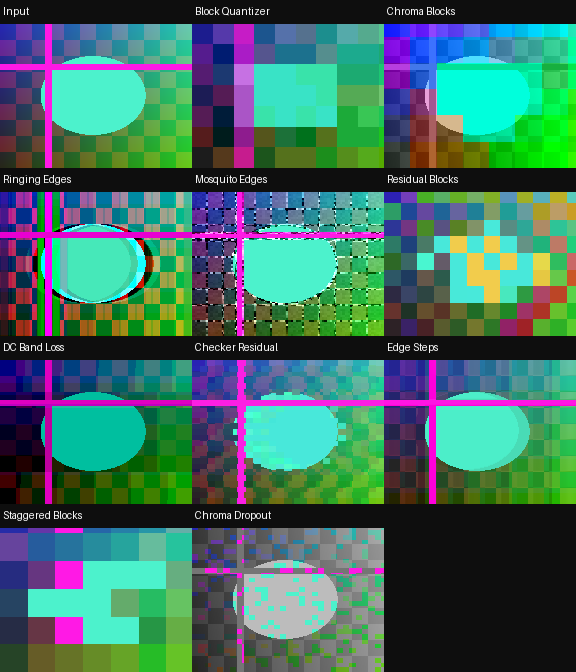

# RecurBoy Compression Artifacts — 10 FX

[Все FX](https://github.com/Guadonna/recurboy_fx_shaders/tree/fx) · [Титульная страница](https://github.com/Guadonna/recurboy_fx_shaders/tree/main) · [Паттерны](https://github.com/Guadonna/recurboy_fx_shaders/tree/patterns)


Блочная квантизация, ошибки цветности, звон границ и остатки предсказания.

Художественная имитация характерных артефактов. JPEG/MPEG-кодек и полноценное DCT в шейдере не выполняются.

## Установка и ручки

В отдельном ZIP шейдеры находятся в `Fx/`; в All Collections — непосредственно в `compression/`, только `.frag`. Документация есть в отдельных ZIP и каталогах категорий ветки fx. Обновление: замените одноимённые файлы. Префиксы шейдеров уникальны для типа эффектов.

На странице EFFECT: ручка 0 — Wet/сброс, 1 и 2 — из таблицы, 3 — штатная скорость и направление часов. Около середины четвёртой ручки модуляция останавливается, видео и память продолжают обновляться. Патч передачи ручки не нужен. Старт: **100% / 55% / 75% / 65%** (у первых пяти Datamosh можно поднять третью ручку до 90%). После смены эффекта подержите Wet=0 несколько кадров.

| Файл | Механизм | Ручка 1 | Ручка 2 | Чтений |
|---|---|---|---|---:|
| `cmp01_block_quantizer.frag` | Усреднённые макроблоки теряют уровни яркости. | Размер макроблока | Потеря уровней | 2 |
| `cmp02_chroma_blocks.frag` | Крупные блоки цветности скользят под яркостной структурой. | Размер цветовых блоков | Смещение цветности | 2 |
| `cmp03_ringing_edges.frag` | Знакопеременные боковые лепестки создают ореолы вокруг резких границ. | Ширина звона | Усиление и квантизация | 5 |
| `cmp04_mosquito_edges.frag` | Мерцающий шум концентрируется около границ объектов. | Масштаб шума | Интенсивность ошибок | 3 |
| `cmp05_residual_blocks.frag` | Квантованные разности обновляют блоки памяти рывками. | Размер блоков | Потеря точности разности | 3 |
| `cmp06_dc_band_loss.frag` | Полосы теряют среднюю яркость и делятся на грубые уровни. | Высота полос | Потеря яркости | 2 |
| `cmp07_checker_residual.frag` | Чётные блоки обновляют разность кадра, нечётные удерживают старые данные. | Размер блоков | Точность остатков | 2 |
| `cmp08_edge_steps.frag` | Ступени квантования усиливаются около контуров. | Ширина контура | Потеря уровней | 2 |
| `cmp09_staggered_blocks.frag` | Строки макроблоков декодируются с разным смещением. | Размер макроблока | Рассогласование | 2 |
| `cmp10_chroma_dropout.frag` | В отдельных блоках пропадает цветность, сохраняя яркость. | Размер блока | Частота выпадений | 1 |

Цвет берётся из источника. RGB-разделение и цветовая интерференция намеренно могут окрашивать ЧБ; остальные варианты проверяются на сохранение ЧБ с чистой памятью. Feedback сохраняет прежние цвета до сброса Wet.

## Производительность и проверки

GLES 2.0 / GLSL ES 1.00, один проход. Новые эффекты используют не более 4 чтений текстур; прежние — до 6. Pixel Sorting целиком ограничен 4 чтениями. **FPS и температура на Raspberry Pi не измерены**, облачные проверки не подтверждают устранение аппаратного зависания. [Проверка на устройстве](docs/performance.md).

Шейдеры с памятью требуют завершённого предыдущего RGB8 framebuffer. Исследованный upstream может читать и писать один буфер, что не определено GLES; отдельный прежний `docs/feedback-pingpong.patch` исправляет это для addon `00dc93725073b1cf5bfc5d4a56e8d3256a995d81`. Если хост уже чередует буферы, патч не нужен. На ARM он здесь не собран. Лицензия addon включена рядом. Pixel Sorting использует только текущее видео.

```sh
python3 -m venv .venv
.venv/bin/pip install -r requirements-dev.txt
EGL_PLATFORM=surfaceless .venv/bin/python tools/validate_collection.py
.venv/bin/python -m unittest discover -s tests -v
.venv/bin/python tools/package.py
```



[Ручки](docs/controls.png) · [Анимация](docs/preview.gif) · [GLES-отчёт](docs/validation.json)

[Общий релиз FX 1.3.0](https://github.com/Guadonna/recurboy_fx_shaders/releases/tag/fx-v1.3.0). В All Collections каждый тип лежит в своей папке без вложенной Fx/ и документации.
