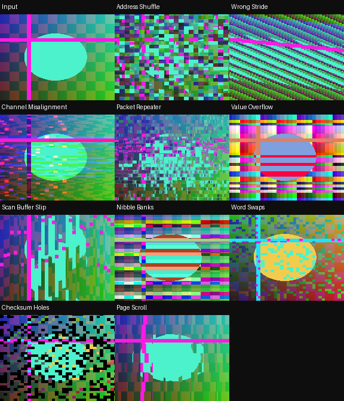

# RecurBoy Databending — 10 FX

[Все FX](https://github.com/Guadonna/recurboy_fx_shaders/tree/fx) · [Титульная страница](https://github.com/Guadonna/recurboy_fx_shaders/tree/main) · [Паттерны](https://github.com/Guadonna/recurboy_fx_shaders/tree/patterns)


Имитация повреждённых адресов, строк, пакетов и значений цветовых данных.

Это визуальные модели ошибок данных; исходный файл или видеопоток не изменяется.

## Установка и ручки

В отдельном ZIP шейдеры находятся в `Fx/`; в All Collections — непосредственно в `databending/`, только `.frag`. Документация есть в отдельных ZIP и каталогах категорий ветки fx. Обновление: замените одноимённые файлы. Префиксы шейдеров уникальны для типа эффектов.

На странице EFFECT: ручка 0 — Wet/сброс, 1 и 2 — из таблицы, 3 — штатная скорость и направление часов. Около середины четвёртой ручки модуляция останавливается, видео и память продолжают обновляться. Патч передачи ручки не нужен. Старт: **100% / 55% / 75% / 65%** (у первых пяти Datamosh можно поднять третью ручку до 90%). После смены эффекта подержите Wet=0 несколько кадров.

| Файл | Механизм | Ручка 1 | Ручка 2 | Чтений |
|---|---|---|---|---:|
| `dbn01_address_shuffle.frag` | Блоки получают адреса других участков изображения. | Размер пакета | Доля перепутанных адресов | 2 |
| `dbn02_wrong_stride.frag` | Неверная длина строки складывает видео в косые пласты. | Шаг адресации | Перекос строки | 2 |
| `dbn03_channel_misalignment.frag` | Цветовые каналы читаются с несовпадающих адресов. | Высота пакетов | Разнос каналов | 3 |
| `dbn04_packet_repeater.frag` | Повреждённые пакеты повторяют чужую область предыдущего кадра. | Размер пакета | Вероятность повтора | 2 |
| `dbn05_value_overflow.frag` | Переполнение яркостей и скачки разрядов разрушают градиенты. | Усиление значения | Разрядность и смещение | 1 |
| `dbn06_scan_buffer_slip.frag` | Куски строк читаются со сдвигом по вертикали. | Длина куска | Сбой адреса | 2 |
| `dbn07_nibble_banks.frag` | Чередующиеся банки значений по-разному переполняют цветовые каналы. | Число банков | Смещение значений | 1 |
| `dbn08_word_swaps.frag` | Повреждённые слова меняют порядок RGB-каналов в блоках. | Размер слов | Плотность перестановок | 1 |
| `dbn09_checksum_holes.frag` | Повреждённые пакеты выпадают в чёрный или сохраняют старые данные. | Размер пакетов | Частота выпадений | 2 |
| `dbn10_page_scroll.frag` | Разные страницы цифрового изображения прокручиваются независимо. | Количество страниц | Сдвиг страницы | 2 |

Цвет берётся из источника. RGB-разделение и цветовая интерференция намеренно могут окрашивать ЧБ; остальные варианты проверяются на сохранение ЧБ с чистой памятью. Feedback сохраняет прежние цвета до сброса Wet.

## Производительность и проверки

GLES 2.0 / GLSL ES 1.00, один проход. Новые эффекты используют не более 4 чтений текстур; прежние — до 6. Pixel Sorting целиком ограничен 4 чтениями. **FPS и температура на Raspberry Pi не измерены**, облачные проверки не подтверждают устранение аппаратного зависания. [Проверка на устройстве](docs/performance.md).

Шейдеры с памятью требуют завершённого предыдущего RGB8 framebuffer. Исследованный upstream может читать и писать один буфер, что не определено GLES; отдельный прежний `docs/feedback-pingpong.patch` исправляет это для addon `00dc93725073b1cf5bfc5d4a56e8d3256a995d81`. Если хост уже чередует буферы, патч не нужен. На ARM он здесь не собран. Лицензия addon включена рядом. Pixel Sorting использует только текущее видео.

```sh
python3 -m venv .venv
.venv/bin/pip install -r requirements-dev.txt
EGL_PLATFORM=surfaceless .venv/bin/python tools/validate_collection.py
.venv/bin/python -m unittest discover -s tests -v
.venv/bin/python tools/package.py
```



[Ручки](docs/controls.png) · [Анимация](docs/preview.gif) · [GLES-отчёт](docs/validation.json)

[Общий релиз FX 1.3.0](https://github.com/Guadonna/recurboy_fx_shaders/releases/tag/fx-v1.3.0). В All Collections каждый тип лежит в своей папке без вложенной Fx/ и документации.
