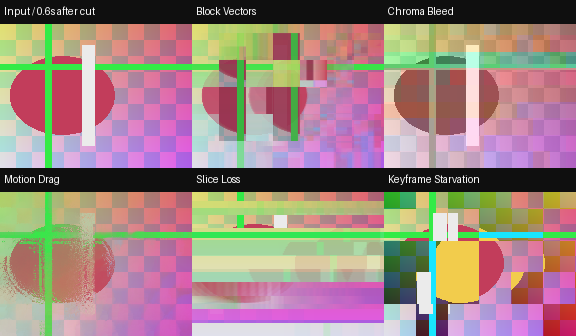
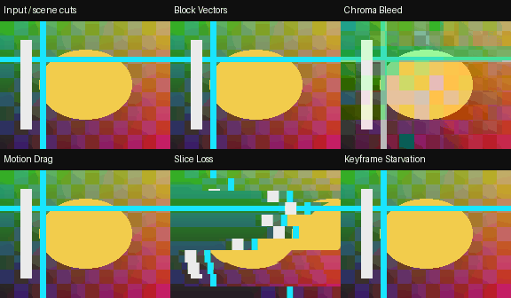

# RecurBoy Datamosh — 5 FX

Пять разных эффектов, воспроизводящих вид повреждённых предсказанных кадров через RGB-feedback. Каждый получает текущее видео и предыдущий результат FX. Это визуальная имитация datamosh: сжатый видеопоток не редактируется, а «векторы движения» оцениваются приблизительно по изображению.

Коллекция: `datamosh`, версия **0.1.0**, ветка **`collections/datamosh`**. Релизы этой подборки имеют собственные теги `datamosh-v…`, отдельно от Organic FX.

## Установка

Распакуйте ZIP подборки. Скопируйте пять `.frag` из `Fx/` в `~/Fx/` на Pi либо в папку `Fx` в корне USB. Префиксы `dm01…dm05` позволяют держать их рядом с предыдущей подборкой.

Выберите эффект в меню FX. Для начала опустите ручку 0 (Wet) в ноль на несколько кадров: это заполнит память исходным видео. Затем поставьте ручки **0/1/2/3 в `100% / 55% / 90% / 65%`**. В `Keyframe Starvation` сброс особенно полезен: иначе до первого обновления некоторые плитки могут содержать чёрный или предыдущий FX-кадр.

Эффекты наиболее заметны на движении и смене сцены. Для жёсткого datamosh удерживайте Wet около 100%; уменьшение Wet сильнее обновляет память текущим изображением.

## Пять характеров

| Файл | Что происходит | Ручка 1 | Ручка 2 | Чтений |
|---|---|---|---|---:|
| `dm01_block_vectors.frag` | Макроблоки старого кадра получают общие ошибочные векторы, съезжают и протекают | Размер блока 4…80 px | Ошибка векторов и память | 6 |
| `dm02_chroma_bleed.frag` | Цвет отстаёт, распадается на блоки и смещается относительно читаемой яркости | Хромаблоки 3…48 px | Разнос цвета и удержание | 4 |
| `dm03_motion_drag.frag` | Движущиеся границы тянут за собой старое изображение непрерывными вязкими следами | Длина движения 1…91 | Сцепление и память | 5 |
| `dm04_slice_loss.frag` | Горизонтальные полосы срываются в стороны и повторяют фрагменты старого изображения | Высота полос 2…40 px | Частота ошибок, сдвиг и память | 3 |
| `dm05_keyframe_starvation.frag` | Плитки удерживают разные моменты прошлого и обновляются в отдельных временных окнах | Размер плитки 4…96 px | Длительность удержания | 2 |

Ручка **0 — Wet / сброс**. Четвёртая физическая ручка, индекс **3**, использует штатную скорость времени RecurBoy: по краям временной рисунок идёт быстрее в противоположных направлениях, около середины — останавливается. Она не перематывает исходное видео назад. При остановленном времени видео и feedback продолжают обновляться; у Keyframe Starvation часть плиток удерживается до движения ручки или сброса Wet.

**Патч передачи четвёртой ручки из предыдущего релиза не нужен.** Все пять шейдеров используют стандартные `u_tex0`, `u_tex1`, `u_resolution`, `u_x0…u_x2`, `ftime` и `v_texcoord`. Патч, если он уже установлен, не мешает этим эффектам.

На ЧБ-входе с чистой памятью все эффекты сохраняют ЧБ. **Chroma Bleed почти не меняет ЧБ-видео**: он работает с цветностью. После цветного источника в feedback может остаться цвет — сбросьте Wet для чистого перехода на ЧБ.

## Производительность и feedback

Один проход, **2–6 чтений текстуры**, без циклов, дополнительных историй кадров, compute-шейдеров и новых сервисов. Цветовая арифметика — `mediump`; точные координаты используются при доступном `highp`. Параметры ограничены диапазоном 0…1.

Начинайте с SD-разрешения и штатных 30 FPS. **25 FPS и нагрев на Raspberry Pi пока не измерены.** Программный рендер Mesa подтверждает работу шейдеров, но не скорость VideoCore. [Проверка на устройстве и термомонитор](docs/performance.md).

Для определённого результата нужен завершённый предыдущий кадр. У изученного upstream RecurBoy/ofxVideoArtTools один framebuffer используется одновременно для чтения и записи; GLES не гарантирует такую схему. В ZIP приложен прежний `docs/feedback-pingpong.patch` к addon ревизии `00dc93725073b1cf5bfc5d4a56e8d3256a995d81`. Это отдельная поправка буферов для feedback, а не подключение четвёртой ручки. Применяйте её только к подходящей версии и с последующей пересборкой; на Pi она здесь не собрана. Если ваша прошивка уже чередует буферы, повторный патч не нужен. Код addon лицензирован GNU GPL v3; копия лицензии лежит рядом с патчем.

## Проверенные примеры

Синтетическое движущееся видео с двумя резкими сменами сцены, настоящий GLES-рендер с RGB8 feedback. Статичная подборка показывает момент через 0.6 секунды после смены сцены.





[Диапазоны ручек](docs/controls.png) · [Отчёт рендера](docs/validation.json)

Проверяются компиляция и линковка всех пяти программ, 240 кадров движения и смен сцен, использование истории, два параметра и четвёртая ручка, ЧБ, сброс, крайние значения и несколько разрешений. Дополнительно проверяется точное удержание плиток и сохранение яркости у Chroma Bleed. Превью не сняты с Raspberry Pi.

## Разработка подборки

Из корня репозитория, после установки `requirements-dev.txt` в `.venv`:

```sh
EGL_PLATFORM=surfaceless .venv/bin/python tools/validate_datamosh.py
.venv/bin/python -m unittest discover -s tests -p 'test_collections.py' -v
.venv/bin/python tools/package_collection.py datamosh
```

Артефакты рендера: `artifacts/datamosh/`. Архив и его SHA-256: `dist/datamosh/`. В ZIP устанавливаемые файлы лежат прямо в `Fx/`; Organic FX в этот архив не входят. Тег `datamosh-v0.1.0` запускает проверки и публикацию отдельного предварительного релиза.
