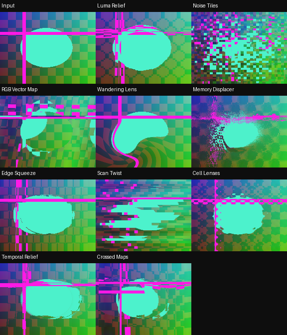

# RecurBoy Displacement Mapping — 10 FX

[Все FX](https://github.com/Guadonna/recurboy_fx_shaders/tree/fx) · [Титульная страница](https://github.com/Guadonna/recurboy_fx_shaders/tree/main) · [Паттерны](https://github.com/Guadonna/recurboy_fx_shaders/tree/patterns)


Смещение изображения по яркости, шуму, цвету и памяти предыдущего кадра.


## Установка и ручки

В отдельном ZIP шейдеры находятся в `Fx/`; в All Collections — непосредственно в `displacement/`, только `.frag`. Документация есть в отдельных ZIP и каталогах категорий ветки fx. Обновление: замените одноимённые файлы. Префиксы шейдеров уникальны для типа эффектов.

На странице EFFECT: ручка 0 — Wet/сброс, 1 и 2 — из таблицы, 3 — штатная скорость и направление часов. Около середины четвёртой ручки модуляция останавливается, видео и память продолжают обновляться. Патч передачи ручки не нужен. Старт: **100% / 55% / 75% / 65%** (у первых пяти Datamosh можно поднять третью ручку до 90%). После смены эффекта подержите Wet=0 несколько кадров.

| Файл | Механизм | Ручка 1 | Ручка 2 | Чтений |
|---|---|---|---|---:|
| `dsp01_luma_relief.frag` | Градиент яркости превращается в рельеф и раздвигает контуры. | Радиус рельефа | Сила смещения | 6 |
| `dsp02_noise_tiles.frag` | Шумовые ячейки растаскивают изображение в независимых направлениях. | Размер ячеек | Разлёт | 2 |
| `dsp03_rgb_vector_map.frag` | Красный и синий каналы служат двумя осями карты смещения. | Поворот поля | Глубина карты | 2 |
| `dsp04_wandering_lens.frag` | Движущаяся линза расширяет и заворачивает видео; яркость центра меняет её силу. | Радиус линзы | Рефракция | 3 |
| `dsp05_memory_displacer.frag` | Перепады старого кадра искривляют текущее видео и оставляют след. | Шаг поля памяти | Деформация и память | 5 |
| `dsp06_edge_squeeze.frag` | Соседние перепады яркости сжимают и растягивают горизонтальные участки. | Шаг карты | Сила растяжения | 3 |
| `dsp07_scan_twist.frag` | Полосы разной высоты поворачивают локальное направление сдвига. | Высота полос | Амплитуда | 2 |
| `dsp08_cell_lenses.frag` | Каждая клетка сетки работает как отдельная линза. | Количество линз | Кривизна | 2 |
| `dsp09_temporal_relief.frag` | Разность текущего и прошлого кадров задаёт смещение по диагонали. | Направление сдвига | Глубина памяти | 3 |
| `dsp10_crossed_maps.frag` | Две смещённые карты яркости управляют разными осями. | Расстояние карт | Сила искажения | 3 |

Цвет берётся из источника. RGB-разделение и цветовая интерференция намеренно могут окрашивать ЧБ; остальные варианты проверяются на сохранение ЧБ с чистой памятью. Feedback сохраняет прежние цвета до сброса Wet.

## Производительность и проверки

GLES 2.0 / GLSL ES 1.00, один проход. Новые эффекты используют не более 4 чтений текстур; прежние — до 6. Pixel Sorting целиком ограничен 4 чтениями. **FPS и температура на Raspberry Pi не измерены**, облачные проверки не подтверждают устранение аппаратного зависания. [Проверка на устройстве](docs/performance.md).

Шейдеры с памятью требуют завершённого предыдущего RGB8 framebuffer. Исследованный upstream может читать и писать один буфер, что не определено GLES; отдельный прежний `docs/feedback-pingpong.patch` исправляет это для addon `00dc93725073b1cf5bfc5d4a56e8d3256a995d81`. Если хост уже чередует буферы, патч не нужен. На ARM он здесь не собран. Лицензия addon включена рядом. Pixel Sorting использует только текущее видео.

```sh
python3 -m venv .venv
.venv/bin/pip install -r requirements-dev.txt
EGL_PLATFORM=surfaceless .venv/bin/python tools/validate_collection.py
.venv/bin/python -m unittest discover -s tests -v
.venv/bin/python tools/package.py
```



[Ручки](docs/controls.png) · [Анимация](docs/preview.gif) · [GLES-отчёт](docs/validation.json)

[Общий релиз FX 1.3.0](https://github.com/Guadonna/recurboy_fx_shaders/releases/tag/fx-v1.3.0). В All Collections каждый тип лежит в своей папке без вложенной Fx/ и документации.
