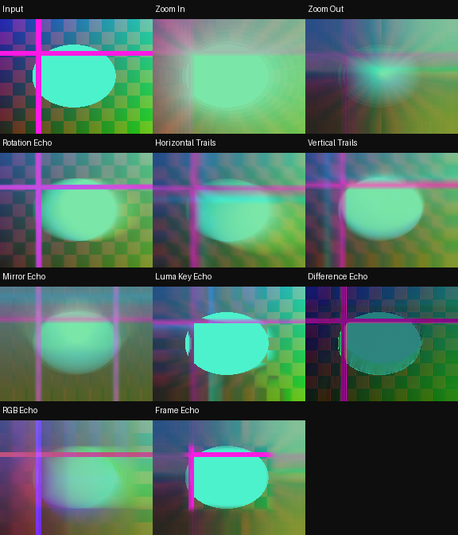

# RecurBoy Classic Feedback — 10 FX

[Все FX](https://github.com/Guadonna/recurboy_fx_shaders/tree/fx) · [Титульная страница](https://github.com/Guadonna/recurboy_fx_shaders/tree/main) · [Паттерны](https://github.com/Guadonna/recurboy_fx_shaders/tree/patterns)


Классическая видеообратная связь: масштаб, поворот, смещение, зеркала, яркостные ключи и цветные эхо.

Один завершённый предыдущий RGB8-кадр; накопление происходит по кадрам.

## Установка и ручки

В отдельном ZIP шейдеры находятся в `Fx/`; в All Collections — непосредственно в `feedback/`, только `.frag`. Документация есть в отдельных ZIP и каталогах категорий ветки fx. Обновление: замените одноимённые файлы. Префиксы шейдеров уникальны для типа эффектов.

На странице EFFECT: ручка 0 — Wet/сброс, 1 и 2 — из таблицы, 3 — штатная скорость и направление часов. Около середины четвёртой ручки модуляция останавливается, видео и память продолжают обновляться. Патч передачи ручки не нужен. Старт: **100% / 55% / 90% / 65%** (у первых пяти Datamosh можно поднять третью ручку до 90%). После смены эффекта подержите Wet=0 несколько кадров.

| Файл | Механизм | Ручка 1 | Ручка 2 | Чтений |
|---|---|---|---|---:|
| `fb01_zoom_in.frag` | Предыдущий кадр плавно увеличивается, оставляя расширяющиеся следы. | Шаг увеличения | Память | 2 |
| `fb02_zoom_out.frag` | Предыдущий кадр сжимается к центру, образуя вложенные контуры. | Шаг уменьшения | Память | 2 |
| `fb03_rotation_echo.frag` | Небольшой поворот каждого прошлого кадра создаёт спиральную память. | Шаг поворота | Память | 2 |
| `fb04_horizontal_trails.frag` | Память уходит влево или вправо, оставляя горизонтальные шлейфы. | Направление и шаг | Длина следа | 2 |
| `fb05_vertical_trails.frag` | Память уходит вверх или вниз, оставляя вертикальные шлейфы. | Направление и шаг | Длина следа | 2 |
| `fb06_mirror_echo.frag` | Зеркальное отражение предыдущего кадра накапливает симметричные двойники. | Сдвиг зеркала | Память | 2 |
| `fb07_luma_key_echo.frag` | Яркие участки обновляют память, тёмные сохраняют старый кадр. | Порог яркости | Удержание | 2 |
| `fb08_difference_echo.frag` | Разность с прошлым кадром порождает пульсирующие контуры движения. | Сдвиг сравнения | Глубина разности | 2 |
| `fb09_rgb_echo.frag` | Три цветовых канала прошлого кадра оставляют разнесённые эхо. | Разнос каналов | Память | 4 |
| `fb10_frame_echo.frag` | Рамка кадра удерживает вложенные копии, оставляя центр читаемым. | Размер окна | Память рамки | 2 |

Цвет берётся из источника. RGB-разделение и цветовая интерференция намеренно могут окрашивать ЧБ; остальные варианты проверяются на сохранение ЧБ с чистой памятью. Feedback сохраняет прежние цвета до сброса Wet.

## Производительность и проверки

GLES 2.0 / GLSL ES 1.00, один проход. Новые эффекты используют не более 4 чтений текстур; прежние — до 6. Pixel Sorting целиком ограничен 4 чтениями. **FPS и температура на Raspberry Pi не измерены**, облачные проверки не подтверждают устранение аппаратного зависания. [Проверка на устройстве](docs/performance.md).

Шейдеры с памятью требуют завершённого предыдущего RGB8 framebuffer. Исследованный upstream может читать и писать один буфер, что не определено GLES; отдельный прежний `docs/feedback-pingpong.patch` исправляет это для addon `00dc93725073b1cf5bfc5d4a56e8d3256a995d81`. Если хост уже чередует буферы, патч не нужен. На ARM он здесь не собран. Лицензия addon включена рядом. Pixel Sorting использует только текущее видео.

```sh
python3 -m venv .venv
.venv/bin/pip install -r requirements-dev.txt
EGL_PLATFORM=surfaceless .venv/bin/python tools/validate_collection.py
.venv/bin/python -m unittest discover -s tests -v
.venv/bin/python tools/package.py
```



[Ручки](docs/controls.png) · [Анимация](docs/preview.gif) · [GLES-отчёт](docs/validation.json)

[Общий релиз FX 1.3.0](https://github.com/Guadonna/recurboy_fx_shaders/releases/tag/fx-v1.3.0). В All Collections каждый тип лежит в своей папке без вложенной Fx/ и документации.
