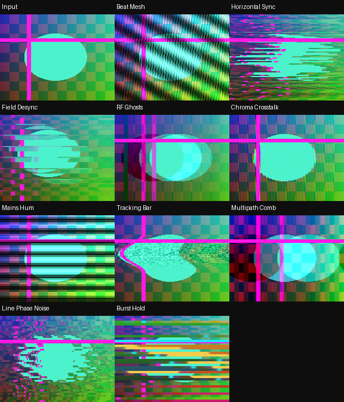

# RecurBoy Signal Interference — 10 FX

[Все FX](https://github.com/Guadonna/recurboy_fx_shaders/tree/fx) · [Титульная страница](https://github.com/Guadonna/recurboy_fx_shaders/tree/main) · [Паттерны](https://github.com/Guadonna/recurboy_fx_shaders/tree/patterns)


Биения, срыв синхронизации, чересстрочные ошибки и отражённые сигналы.


## Установка и ручки

В отдельном ZIP шейдеры находятся в `Fx/`; в All Collections — непосредственно в `interference/`, только `.frag`. Документация есть в отдельных ZIP и каталогах категорий ветки fx. Обновление: замените одноимённые файлы. Префиксы шейдеров уникальны для типа эффектов.

На странице EFFECT: ручка 0 — Wet/сброс, 1 и 2 — из таблицы, 3 — штатная скорость и направление часов. Около середины четвёртой ручки модуляция останавливается, видео и память продолжают обновляться. Патч передачи ручки не нужен. Старт: **100% / 55% / 75% / 65%** (у первых пяти Datamosh можно поднять третью ручку до 90%). После смены эффекта подержите Wet=0 несколько кадров.

| Файл | Механизм | Ручка 1 | Ручка 2 | Чтений |
|---|---|---|---|---:|
| `sig01_beat_mesh.frag` | Близкие частоты образуют крупные движущиеся биения. | Частота несущей | Расстройка частот | 1 |
| `sig02_horizontal_sync.frag` | Строки скачут в стороны при потере горизонтальной синхронизации. | Число групп строк | Срыв синхронизации | 2 |
| `sig03_field_desync.frag` | Чётные и нечётные полосы читаются с противоположными временными сдвигами. | Толщина поля | Расхождение полей | 3 |
| `sig04_rf_ghosts.frag` | Два отражения сигнала создают дрожащие телевизионные двойники. | Задержка отражений | Сила отражений | 3 |
| `sig05_chroma_crosstalk.frag` | Несинхронный цветовой носитель создаёт цветные помехи на контурах. | Частота носителя | Связь яркости и цвета | 2 |
| `sig06_mains_hum.frag` | Широкие бегущие полосы яркости имитируют сетевой фон. | Частота фона | Глубина помехи | 1 |
| `sig07_tracking_bar.frag` | Плавающая полоса нарушения трекинга сдвигает и зашумляет видео. | Ширина полосы | Срыв трекинга | 2 |
| `sig08_multipath_comb.frag` | Два отражённых сигнала образуют гребенчатые края. | Задержка | Сила отражения | 3 |
| `sig09_line_phase_noise.frag` | Фаза каждой группы строк меняется независимо. | Число групп | Размах фазового шума | 2 |
| `sig10_burst_hold.frag` | Короткие выпадения сигнала удерживают прошлое изображение в полосах. | Высота полос | Частота выпадений | 2 |

Цвет берётся из источника. RGB-разделение и цветовая интерференция намеренно могут окрашивать ЧБ; остальные варианты проверяются на сохранение ЧБ с чистой памятью. Feedback сохраняет прежние цвета до сброса Wet.

## Производительность и проверки

GLES 2.0 / GLSL ES 1.00, один проход. Новые эффекты используют не более 4 чтений текстур; прежние — до 6. Pixel Sorting целиком ограничен 4 чтениями. **FPS и температура на Raspberry Pi не измерены**, облачные проверки не подтверждают устранение аппаратного зависания. [Проверка на устройстве](docs/performance.md).

Шейдеры с памятью требуют завершённого предыдущего RGB8 framebuffer. Исследованный upstream может читать и писать один буфер, что не определено GLES; отдельный прежний `docs/feedback-pingpong.patch` исправляет это для addon `00dc93725073b1cf5bfc5d4a56e8d3256a995d81`. Если хост уже чередует буферы, патч не нужен. На ARM он здесь не собран. Лицензия addon включена рядом. Pixel Sorting использует только текущее видео.

```sh
python3 -m venv .venv
.venv/bin/pip install -r requirements-dev.txt
EGL_PLATFORM=surfaceless .venv/bin/python tools/validate_collection.py
.venv/bin/python -m unittest discover -s tests -v
.venv/bin/python tools/package.py
```



[Ручки](docs/controls.png) · [Анимация](docs/preview.gif) · [GLES-отчёт](docs/validation.json)

[Общий релиз FX 1.3.0](https://github.com/Guadonna/recurboy_fx_shaders/releases/tag/fx-v1.3.0). В All Collections каждый тип лежит в своей папке без вложенной Fx/ и документации.
