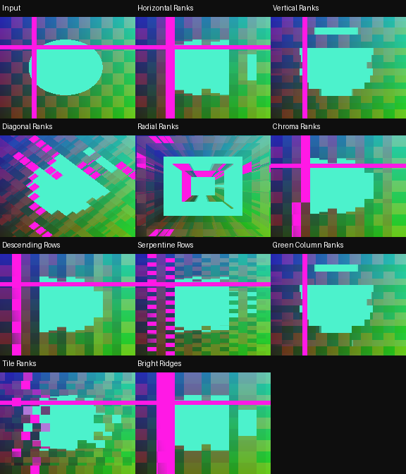

# RecurBoy Pixel Sorting — 10 FX

[Все FX](https://github.com/Guadonna/recurboy_fx_shaders/tree/fx) · [Титульная страница](https://github.com/Guadonna/recurboy_fx_shaders/tree/main) · [Паттерны](https://github.com/Guadonna/recurboy_fx_shaders/tree/patterns)


Упорядочивание цветных выборок в вытянутые полосы по яркости или цвету.

Оптимизированная локальная сортировка трёх выборок: 4 чтения текстур вместо 6, 3 сравнения вместо 10, ключи вычисляются один раз. Нет inout-сети сортировки, atan/sin/cos/pow и циклов. Это сортировка короткого сегмента, а не всей строки. Радиальные лучи используют квадратную метрику. Аппаратное устранение зависаний требует проверки на вашей Pi.

## Установка и ручки

В отдельном ZIP шейдеры находятся в `Fx/`; в All Collections — непосредственно в `pixel-sorting/`, только `.frag`. Документация есть в отдельных ZIP и каталогах категорий ветки fx. Обновление: замените одноимённые файлы. Префиксы шейдеров уникальны для типа эффектов.

На странице EFFECT: ручка 0 — Wet/сброс, 1 и 2 — из таблицы, 3 — штатная скорость и направление часов. Около середины четвёртой ручки модуляция останавливается, видео и память продолжают обновляться. Патч передачи ручки не нужен. Старт: **100% / 55% / 75% / 65%** (у первых пяти Datamosh можно поднять третью ручку до 90%). После смены эффекта подержите Wet=0 несколько кадров.

| Файл | Механизм | Ручка 1 | Ручка 2 | Чтений |
|---|---|---|---|---:|
| `srt01_horizontal_ranks.frag` | Горизонтальные ранги яркости. | Длина сегмента | Включённые яркости | 4 |
| `srt02_vertical_ranks.frag` | Вертикальные ранги яркости. | Длина сегмента | Включённые яркости | 4 |
| `srt03_diagonal_ranks.frag` | Диагональные ленты без вычисления тригонометрии. | Длина сегмента | Включённые яркости | 4 |
| `srt04_radial_ranks.frag` | Лучи сортировки на лёгкой квадратной радиальной метрике. | Длина сегмента | Включённые яркости | 4 |
| `srt05_chroma_ranks.frag` | Лёгкая сортировка по разнице красного и синего. | Длина сегмента | Включённые яркости | 4 |
| `srt06_descending_rows.frag` | Яркость убывает вдоль горизонтальных полос. | Длина сегмента | Включённые яркости | 4 |
| `srt07_serpentine_rows.frag` | Направление рангов чередуется в соседних полосах. | Длина сегмента | Включённые яркости | 4 |
| `srt08_green_column_ranks.frag` | Вертикальная сортировка по разнице зелёного и красного. | Длина сегмента | Включённые яркости | 4 |
| `srt09_tile_ranks.frag` | Клетки переставляют три яркостных ранга внутри локальных рядов. | Длина сегмента | Включённые яркости | 4 |
| `srt10_bright_ridges.frag` | Самый светлый ранг образует центральные гребни полос. | Длина сегмента | Включённые яркости | 4 |

Цвет берётся из источника. RGB-разделение и цветовая интерференция намеренно могут окрашивать ЧБ; остальные варианты проверяются на сохранение ЧБ с чистой памятью. Feedback сохраняет прежние цвета до сброса Wet.

## Производительность и проверки

GLES 2.0 / GLSL ES 1.00, один проход. Новые эффекты используют не более 4 чтений текстур; прежние — до 6. Pixel Sorting целиком ограничен 4 чтениями. **FPS и температура на Raspberry Pi не измерены**, облачные проверки не подтверждают устранение аппаратного зависания. [Проверка на устройстве](docs/performance.md).

Шейдеры с памятью требуют завершённого предыдущего RGB8 framebuffer. Исследованный upstream может читать и писать один буфер, что не определено GLES; отдельный прежний `docs/feedback-pingpong.patch` исправляет это для addon `00dc93725073b1cf5bfc5d4a56e8d3256a995d81`. Если хост уже чередует буферы, патч не нужен. На ARM он здесь не собран. Лицензия addon включена рядом. Pixel Sorting использует только текущее видео.

```sh
python3 -m venv .venv
.venv/bin/pip install -r requirements-dev.txt
EGL_PLATFORM=surfaceless .venv/bin/python tools/validate_collection.py
.venv/bin/python -m unittest discover -s tests -v
.venv/bin/python tools/package.py
```



[Ручки](docs/controls.png) · [Анимация](docs/preview.gif) · [GLES-отчёт](docs/validation.json)

[Общий релиз FX 1.3.0](https://github.com/Guadonna/recurboy_fx_shaders/releases/tag/fx-v1.3.0). В All Collections каждый тип лежит в своей папке без вложенной Fx/ и документации.
